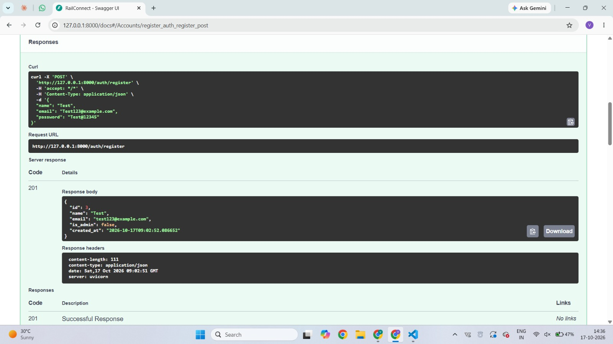
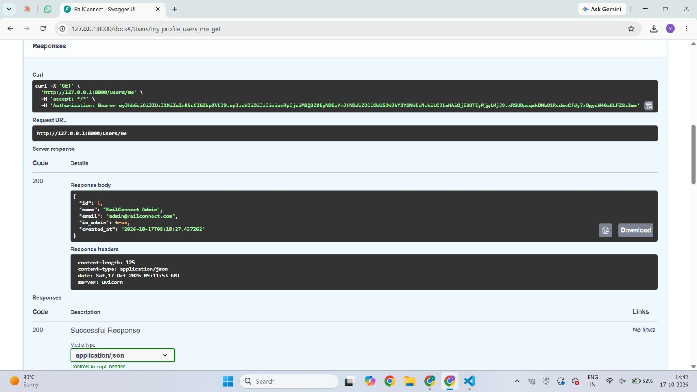
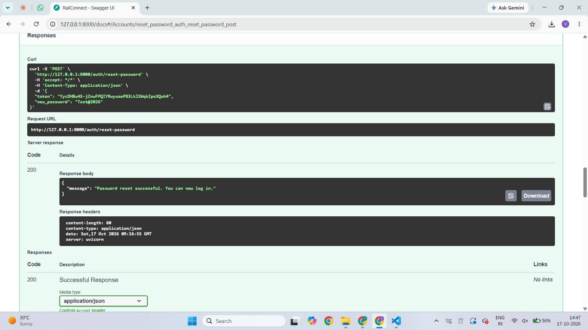
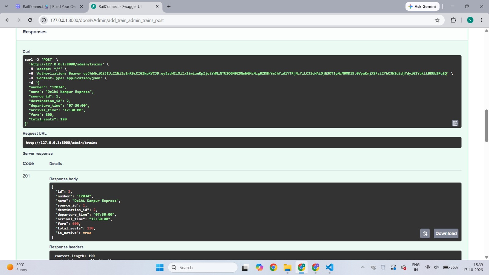
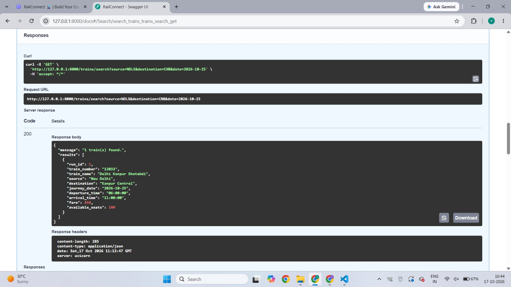
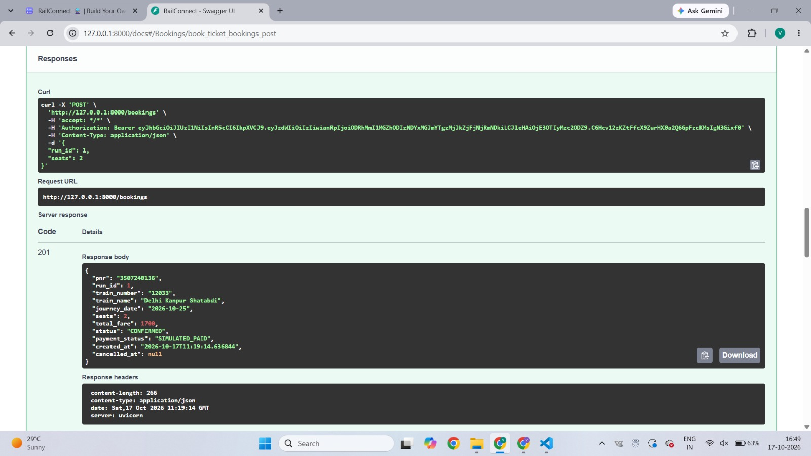
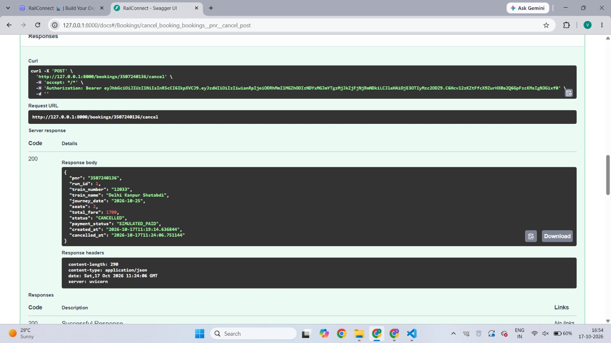
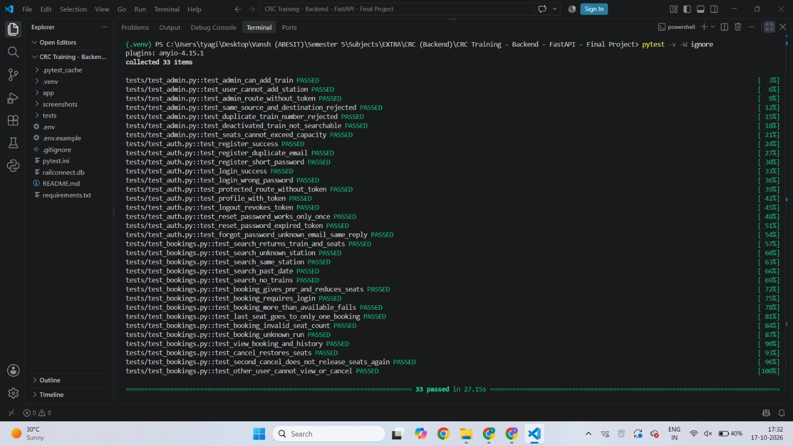

# RailConnect: Railway Booking Backend

RailConnect is a mini railway booking backend built with **FastAPI**. Admins manage stations, trains, journey dates, fares and seats. Passengers create accounts, search trains, book tickets, receive a PNR and cancel bookings.

## Features

**Accounts**
- Register and log in, with passwords hashed using **bcrypt**
- **JWT** tokens (python-jose) protect private APIs
- Logout, forgot password and reset password
- Users can see only their own profile and bookings

**Admin control**
- Add, update, activate and deactivate trains
- Add stations, journey dates (runs), fares and seat availability
- All admin APIs are restricted to administrators (403 for normal users)

**Find a train**
- Search by source station, destination station and journey date
- Shows timings, fare and available seats
- Handles unknown stations, same source and destination, past dates and no matching trains

**Booking**
- Book 1 to 6 seats and receive a unique 10-digit PNR
- Booking confirmation, booking history and cancellation
- Seat count updates after every booking and cancellation
- Simulated payment status (`SIMULATED_PAID`), with no real payments

**Reliability**
- SQLite database through SQLModel
- Input validation with clear error messages
- Database transactions for booking and cancellation
- 33 automated tests covering success and failure cases

## Tech stack and packages

Python 3.11+, FastAPI, Uvicorn, SQLModel, SQLite, Pydantic, pydantic-settings, python-jose[cryptography], bcrypt, email-validator, httpx, pytest.

## Installation

```bash
# 1. Clone the repository
git clone https://github.com/vanshtyagi42/CRC-Training-Backend-FastAPI-Final-Project-Rail-Connect.git 
cd CRC-Training-Backend-FastAPI-Final-Project-Rail-Connect  

# 2. Create and activate a virtual environment (Windows)
python -m venv .venv
.venv\Scripts\activate

# 3. Install packages
pip install -r requirements.txt

# 4. Create your environment file and edit the values
copy .env.example .env
```

Open `.env` and set a long random `SECRET_KEY`. You can generate one with:

```bash
python -c "import secrets; print(secrets.token_hex(32))"
```

`.env` is never committed. The first admin account is created automatically on startup from `ADMIN_EMAIL` and `ADMIN_PASSWORD` in `.env`. Registration can never create an admin.

## Run the server

```bash
uvicorn app.main:app --reload
```

Open the interactive docs at http://127.0.0.1:8000/docs

## Run the tests

```bash
pytest -v
```

Tests use a temporary in-memory database, so your real data is never touched.

## Important API endpoints

| Method | Endpoint | Access | Purpose |
|---|---|---|---|
| POST | `/auth/register` | Public | Create an account |
| POST | `/auth/login` | Public | Log in and get a JWT |
| POST | `/auth/logout` | User | Revoke the current token |
| POST | `/auth/forgot-password` | Public | Request a reset token (printed to the console) |
| POST | `/auth/reset-password` | Public | Set a new password with the token |
| GET | `/users/me` | User | View own profile |
| GET | `/users/me/bookings` | User | View own booking history |
| GET | `/trains/search?source=&destination=&date=` | Public | Search trains and seats |
| POST | `/bookings` | User | Book a ticket and get a PNR |
| GET | `/bookings/{pnr}` | User | View own booking |
| POST | `/bookings/{pnr}/cancel` | User | Cancel own booking |
| POST / GET | `/admin/stations` | Admin | Add or list stations |
| POST / GET | `/admin/trains` | Admin | Add or list trains |
| PUT | `/admin/trains/{id}` | Admin | Update a train |
| PATCH | `/admin/trains/{id}/deactivate` | Admin | Deactivate a train |
| PATCH | `/admin/trains/{id}/activate` | Admin | Reactivate a train |
| POST / GET | `/admin/trains/{id}/runs` | Admin | Add or list journey dates with seats |
| PATCH | `/admin/runs/{id}/seats` | Admin | Update seat availability |

## How it works

**Logout.** JWTs are stateless, so every token carries a unique `jti`. On logout the `jti` is stored in a `RevokedToken` table, and any request using that token afterwards gets 401.

**Forgot and reset password.** A reset token is generated, and only its SHA-256 hash is stored. It expires after 15 minutes and works only once. The "email" is a development simulation printed in the server console. The reply is the same whether or not the email exists, so registered emails can't be discovered.

**Seats per date.** Seats are stored per train per journey date (`TrainRun`), so booking on one date never affects another date.

**No double booking.** Seats are reduced with one atomic SQL statement that runs only if enough seats remain. If two people try for the last seat at the same moment, only one succeeds and the other gets 409. The seat change and the booking are saved in one transaction, so both happen or neither does.

**No repeated seat release.** Cancelling changes the status from `CONFIRMED` to `CANCELLED` in a single guarded statement. Only the first cancel request releases seats, and a second one gets 409.

**Privacy.** Booking lookups are filtered by the logged-in user. Another user's PNR returns 404, the same as a PNR that does not exist.

## Screenshots

### 1. Signup and login


### 2. Failed login and unauthorized access


### 3. Forgot password and reset password


### 4. Admin adding a train


### 5. Searching for a train and checking seats


### 6. Booking a ticket and receiving a PNR


### 7. Viewing and cancelling a booking


### 8. Tests running successfully
 